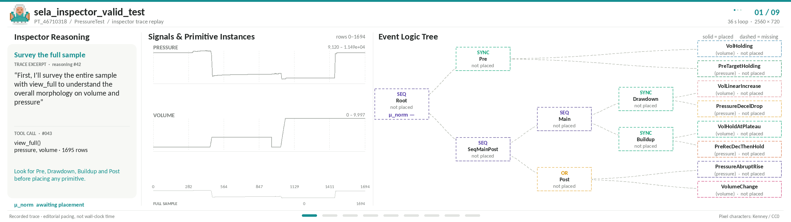

<h1 align="center"><i>Grammar of the Wave</i></h1>

<h3 align="center">
  Towards Explainable Multivariate Time Series Event Detection via <br> Neuro-Symbolic VLM Agents
</h3>

<p align="center">
  
</p>

<p align="center">
<p align="center">
    <a href="https://aclanthology.org/2026.emnlp-main.290/">Paper</a>
    ·
    <a href="https://github.com/cw-wan/SELA/blob/main/SELA_EMNLP26_Slides.pdf">Slides*</a>
    ·
    <a href="https://github.com/cw-wan/SELA/blob/main/SELA_EMNLP26_Poster.pdf">Poster</a>
</p>
<span style="font-size: 60%;">* <i>Oral presentation at <a href="https://sites.google.com/view/paris-nlp-pre-conf-oct-2026/">Paris NLP Pre-Conference 2026 Oct Edition</a>, <a href="https://www.inria.fr/fr/centre-inria-de-paris">Inria Paris</a>.</i></span>
</p>

<p align="center">
  
</p>

<p align="center">
  <em>SELA Inspector: Interactive visualization of neuro-symbolic event detection and explainable evidence.</em>
</p>


## KITE Datasets

Every command below takes `--dataset <NAME>`; the two shipped sets are:

| `<NAME>` | Samples | Classes |   `<K>`   |
|---|:---:|---|:---------:|
| `PressureTest` | 62 | `valid test`, `lost seal` | 1 |
| `ClimateHazard` | 86 | `dense_fog`, `extreme_cold_wind_chill`, `frost_freeze` | 4 |

`<K>` is the bbox-head query count (`--num-queries`). Substitute `<NAME>` and
`<K>` from this table.

A dataset directory is `data/<NAME>/` with `desc.txt` (the natural-language
class description), `labels.csv`, and `timeseries/*.csv`. Adding
your own is a matter of matching that layout.

## Setup

```bash
pip install -r requirements.txt

# LLM credentials (Azure OpenAI / OpenAI)
cp config/llm.example.json config/llm.json   # then fill in your endpoint + key

# one-time extras for the TS-foundation-model baselines (needs torch + CUDA)
pip install --no-deps momentfm chronos-forecasting
```

Every run streams progress to `logs/<run>/…log` and writes `results.json`.

## Metrics

`sela/eval/metrics.py`. Detection F1 at IoU 0.5 and 0.9, micro (pooled events) and macro (equal weight per class). Coverage F-scores are also reported:
`cov_f1` and `cov_f05`. Coverage F-scores are built from range recall (overlap / |gt|) and range precision (overlap / |pred|); the `05` in `cov_f05` is
β = 0.5, i.e. precision-weighted. They are the informative pair on datasets whose event boundaries are gradual.

## SELA

```bash
# GPT-5
python scripts/evaluate_sela.py --model gpt-5 --dataset <NAME> --concurrency 5 \
    --numeric-readout --numeric-max-rows 80 --resample-mode envelope --parallel-inspectors

# GPT-4.1
python scripts/evaluate_sela.py --model gpt-4.1 --dataset <NAME> --concurrency 8 \
    --numeric-readout --numeric-max-rows 40 --resample-mode envelope
```

## Supervised models

Repeated 5-fold Cross Validation: run each command with `--seed 42`, `--seed 43`, `--seed 44`
and aggregate across the three seeds.

```bash
# from-scratch CNN / Transformer — per-timestep seq head
python scripts/train_supervised.py --model cnn         --dataset <NAME> --folds 5 --epochs 60
python scripts/train_supervised.py --model transformer --dataset <NAME> --folds 5 --epochs 60

# TS foundation models — frozen backbone + DETR-lite bbox head
python scripts/train_supervised.py --model moment  --dataset <NAME> --folds 5 --epochs 30 --head-mode bbox --num-queries <K>
python scripts/train_supervised.py --model chronos --dataset <NAME> --folds 5 --epochs 30 --head-mode bbox --num-queries <K>
python scripts/train_supervised.py --model timer   --dataset <NAME> --folds 5 --epochs 30 --head-mode bbox --num-queries <K>
python scripts/train_supervised.py --model timesfm --dataset <NAME> --folds 5 --epochs 30 --head-mode bbox --num-queries <K>
```

## VLM baselines

```bash
# Numeric
python scripts/evaluate_baseline.py --baseline numeric --model gpt-5   --dataset <NAME> --repeats 3 --seed 44 --concurrency 12
python scripts/evaluate_baseline.py --baseline numeric --model gpt-4.1 --dataset <NAME> --repeats 3 --seed 44 --concurrency 12

# VL-Time
python scripts/evaluate_baseline.py --baseline visual  --model gpt-5   --dataset <NAME> --repeats 3 --seed 44 --concurrency 12
python scripts/evaluate_baseline.py --baseline visual  --model gpt-4.1 --dataset <NAME> --repeats 3 --seed 44 --concurrency 12
```

Few-shot — add `--few-shot` to any of the above. One random example per class is drawn per query, the query
itself excluded, resampled every run:

```bash
python scripts/evaluate_baseline.py --baseline visual --model gpt-5 --dataset <NAME> --repeats 3 --seed 44 --few-shot --concurrency 6
```

## Citation

If you find our work useful, please cite our paper:

```bibtex
@inproceedings{wan-etal-2026-grammar,
    title = "Grammar of the Wave: Towards Explainable Multivariate Time Series Event Detection via Neuro-Symbolic {VLM} Agents",
    author = "Wan, Sky Chenwei  and
      Wang, Yifei  and
      Hou, Tianjun  and
      Chang, Xiqing  and
      Jan, Aymeric",
    editor = "Lee, Hung-Yi  and
      Dev, Sunipa  and
      Li, Jessy  and
      Elliott, Desmond",
    booktitle = "Proceedings of the 2026 Conference on Empirical Methods in Natural Language Processing",
    month = oct,
    year = "2026",
    address = "Budapest, Hungary",
    publisher = "Association for Computational Linguistics",
    url = "https://aclanthology.org/2026.emnlp-main.290/",
    doi = "10.18653/2026.emnlp-main.290",
    pages = "6638--6656",
    ISBN = "979-8-89176-459-0"
}
```
